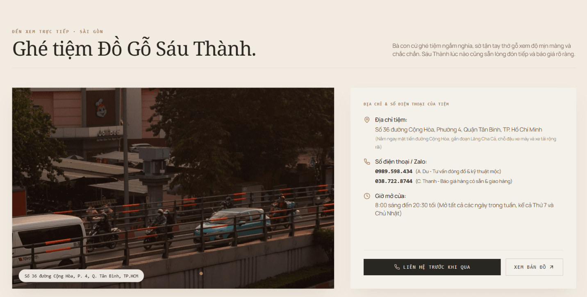

# Đồ Gỗ Sáu Thành

Official showcase website for **Đồ Gỗ Sáu Thành** — a family-owned traditional woodcraft workshop in Ho Chi Minh City.

**Live Demo:** [sauthanh.vercel.app](https://sauthanh.vercel.app)

---

## About This Project

Growing up around my parents' woodworking business, I always dreamed of one day building a website for them with my own hands.

What started as a childhood wish has finally come to life. This project is more than just a showcase of woodcraft—it's a personal milestone and my way of bringing my family's craftsmanship to the digital world.

---

## Preview




---

## Tech Stack

- **Framework:** React 18, JavaScript (ES6+)
- **Styling:** Tailwind CSS
- **Animation:** GSAP (ScrollTrigger)
- **Build Tool:** Vite

---

## Key Features

- **Product Catalog & Filtering:** Browse furniture by category with instant filtering.
- **Lightbox Gallery:** Keyboard-accessible image modal with prev/next navigation.
- **Responsive Design:** Clean layout adapted for both desktop and mobile screens.
- **Showroom & Contact:** Quick consultation modal and a direct Google Maps link.

---

## Run Locally

```bash
git clone https://github.com/vietluu0305/sau-thanh.git
cd sau-thanh
npm install
npm run dev
```

Open `http://localhost:3000` in your browser.
